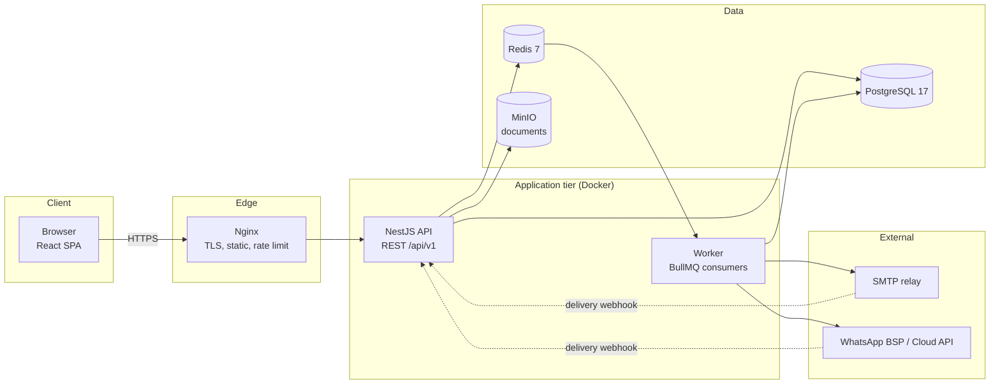

# Technical Stack PRD

## Visitors Appointment Management System (VAMS)

**Client:** Transport, Roads & Buildings (T,R&B) Department
**Derived from:** `prd.md` v1.0 (product requirements)
**Document type:** Technology selection & architecture requirements
**Status:** Draft v1.0 — pending approval (see §14 decisions)
**Date:** 17 November 2026

---

## 1. Purpose & How to Read This Document

This document converts the product requirements in `prd.md` into a concrete, buildable technology stack. Every requirement below traces to a product requirement (FR-x / NFR) or exists to satisfy a stated non-functional constraint.

It is written as a **decision document**, not a tutorial: each layer states the choice, the rationale, the rejected alternatives, and the conditions under which the decision should be revisited.

**Non-negotiable constraints driving every choice**

| Constraint | Consequence |
|---|---|
| Government department deployment, likely on-premises or MeitY-empanelled cloud | Self-hostable open-source stack; no hard dependency on a single SaaS vendor |
| Small user base (peshi staff + Secretary + admin; single-digit concurrency) | Favor a modular monolith over microservices; no Kubernetes |
| PII (mobile, email, purpose of visit) with audit obligations | Encryption in transit, least-privilege DB access, append-only audit, no PII in application logs |
| Two outbound channels (SMTP + official WhatsApp Business API) | Provider-agnostic adapter layer + durable queue + delivery tracking |
| Paper-slip replacement must be faster than paper | Sub-second intake interactions; no heavy client framework bootstrap |
| 5-milestone delivery (M1–M5) by a small team | One language across API and UI; minimal moving parts; Docker Compose deployment |

---

## 2. Recommended Stack at a Glance

| Layer | Choice | Version target |
|---|---|---|
| **UI** | React + TypeScript + Vite | React 19, Vite 7, TS 5.x |
| **UI components** | Tailwind CSS + shadcn/ui (Radix primitives) | latest stable |
| **Forms/validation** | React Hook Form + Zod (shared schemas) | latest stable |
| **Data fetching** | TanStack Query + typed OpenAPI client | latest stable |
| **API** | Node.js + NestJS (TypeScript), REST/OpenAPI 3.1 | Node 24 LTS, Nest 11 |
| **Validation (server)** | Zod (same schemas as UI) | latest stable |
| **Database** | PostgreSQL with `pg_trgm` and full-text search | PG 17 (18 acceptable) |
| **ORM / migrations** | Prisma ORM + Prisma Migrate | latest stable |
| **Queue / retries** | Redis + BullMQ (outbox-driven workers) | Redis 7, BullMQ 5 |
| **Auth** | Server-side sessions (httpOnly cookie) + Argon2id + RBAC guard | — |
| **File storage** | S3-compatible MinIO (on-prem) + ClamAV scan | latest stable |
| **Email** | Nodemailer over department SMTP relay (or SES/NIC gateway) | — |
| **WhatsApp** | Meta WhatsApp Cloud API via a BSP adapter (Gupshup / Twilio / Interakt) | — |
| **PDF/Excel export** | ExcelJS (XLSX), Playwright headless Chromium (PDF) | — |
| **Reverse proxy / TLS** | Nginx + department-issued certificates | 1.27+ |
| **Packaging** | Docker + Docker Compose (app, db, redis, minio, worker, proxy) | — |
| **CI/CD** | GitLab CI or GitHub Actions; Trivy + `npm audit` gates | — |
| **Observability** | OpenTelemetry → Prometheus + Grafana + Loki | — |
| **Testing** | Vitest (unit), Supertest (API), Playwright (E2E), k6 (load) | — |
| **Repo layout** | pnpm workspace monorepo | pnpm 9+ |

Everything above is open-source and self-hostable; the only paid items are WhatsApp conversation fees and (optionally) email delivery.

---

## 3. Architecture

**Style: modular monolith + background worker.** A single deployable API process and a separate worker process share one codebase and one database. Rationale: the load does not justify distributed systems, but notification dispatch *must* be asynchronous and retryable, which is the only genuine reason for a second process.

**Module boundaries (NestJS modules, one per product area)**

| Module | Owns | PRD refs |
|---|---|---|
| `auth` | login, sessions, password policy, RBAC guard | §4, NFR RBAC |
| `visitors` | visitor profiles, lookup, auto-fill, history | FR-1.1–1.5 |
| `requests` | appointment requests, status machine | FR-2.1–2.4 |
| `scheduling` | slot assignment, conflict checks, reschedule | FR-2.2–2.3 |
| `notifications` | outbox, templates, adapters, delivery status, retries | FR-3.1–3.4 |
| `search` | register query, filters, exports | FR-4.1–4.4 |
| `audit` | append-only audit writer + reader | FR-5.1–5.2 |
| `admin` | users, roles, configuration, provider credentials | §4, NFR |

**Rules**

- Modules communicate through service interfaces, never by reaching into each other's tables.
- Cross-cutting concerns (auth guard, audit interceptor, request ID, error filter) are framework-level, applied once.
- No cross-module database joins in controllers; use service composition or read models.

---

## 4. Frontend Requirements

| Concern | Decision | Rationale / notes |
|---|---|---|
| Framework | React 19 SPA (Vite build), TypeScript strict mode | Fastest iteration for form-heavy internal apps; no SSR need |
| Routing | React Router 7 | Mature, simple |
| Styling | Tailwind CSS + shadcn/ui (Radix) | Accessible primitives, no design-system build-out; meets keyboard/focus NFR |
| Forms | React Hook Form + Zod resolvers | The intake form is the core UX; uncontrolled inputs keep typing instant |
| Shared validation | Zod schemas in `packages/shared` used by both UI and API | One source of truth for required fields, mobile/email formats |
| Server state | TanStack Query (cache, retries, optimistic UI) | Intake lookup debounce/abort + approval refresh |
| API client | Generated from OpenAPI 3.1 (`openapi-typescript` + `openapi-fetch`) | Compile-time safety on FR endpoints |
| Tables | TanStack Table (headless) + shadcn table | FR-4.1 column sorting/filtering/pagination |
| Date/time | `date-fns` + `date-fns-tz` | IST display, `DD-MM-YYYY` per PRD |
| Accessibility | Radix primitives, labeled inputs, focus rings, keyboard dialogs | NFR accessibility |
| Bundle policy | Route-level code splitting; **intake and approval routes preloaded** | Intake must feel instant at the counter |
| Browser support | Last 2 versions of Chrome/Edge/Firefox; responsive down to 1024px | PRD NFR compatibility |
| No client-side secrets | All provider credentials server-side only | Security |

**Screen-to-requirement map (build order)**

1. Login / session-expired (`auth`)
2. Intake form with lookup panel + history table (FR-1.1–1.5)
3. Secretary pending queue (FR-2.1)
4. Request detail + approve/reject/date-time dialog (FR-2.2, FR-2.4)
5. Status lists: Pending / Approved / Rejected / Materialized (FR-2.3)
6. Register search + filters + export (FR-4.1–4.3)
7. Audit log viewer (FR-5.2)
8. Admin: users, roles, templates, provider config (NFR)

---

## 5. Backend Requirements

| Concern | Decision | Notes |
|---|---|---|
| Runtime/framework | Node 24 LTS + NestJS 11 | DI, modules, guards, interceptors match the module boundaries; one language across tiers |
| API style | REST, JSON, `/api/v1`, OpenAPI 3.1 generated from decorators | Contract published to the UI build and to UAT testers |
| Error format | RFC 9457 problem+json | Consistent client handling |
| IDs | UUIDv7 for internal PKs + short human-readable `VAMS-YYYY-#####` reference | Reference is what staff quote to visitors |
| Timezone | Store UTC (`timestamptz`), render IST (Asia/Kolkata) | Prevents slot ambiguity |
| Approval idempotency | Require `Idempotency-Key` on approve/reject; unique constraint on `(request_id, decision)` | Prevents duplicate notifications (FR-3.4) |
| Status transitions | Explicit state machine in `requests` service; illegal transitions throw 409 | FR-2.3 forward-only rules |
| Concurrency | Optimistic locking (`version` column) on request rows | Two Secretary tabs must not double-approve |
| Rate limiting | Nginx + Nest throttler on login and lookup endpoints | Lookup is debounced but must be abuse-safe |
| File uploads | Direct-to-MinIO presigned PUT, server-side MIME/size allowlist, ClamAV scan job | Resolves PRD OQ-5 if attachments approved |
| Exports | Streamed XLSX/CSV generation, role-gated, writes audit entry | FR-4.3 |
| PDF | Daily schedule + appointment confirmation rendered via headless Chromium | FR-4.3 recommended output |
| Background jobs | BullMQ queues: `notify-email`, `notify-whatsapp`, `retry`, `scan-file`, `export` | FR-3.4 |

**Resolves PRD open questions at the technical layer**

- OQ-4 (who marks Materialized): enforced by RBAC permission `request:materialize`, assigned by admin — the stack does not hardcode the answer.
- OQ-5 (attachments): storage and scanning exist behind a feature flag; enabling is config-only.
- OQ-6 (slot capacity): scheduling service exposes a configurable `maxPerSlot` setting, default unlimited.

---

## 6. Data Layer Requirements

**PostgreSQL 17** as the single system of record. No second datastore for v1.

| Requirement | Implementation |
|---|---|
| Schema management | Prisma Migrate; migrations reviewed and applied in CI, never hand-run in production |
| Key indexes | `visitor.mobile_normalized`, `visitor.email_normalized`, `visitor.name_trgm`, `request.status`, `request.assigned_date`, `request.request_date`, `notification.request_id` |
| Fuzzy/partial lookup (FR-1.3) | `pg_trgm` GIN index + `similarity()`/`ILIKE` ranked search across name, designation, organization, mobile, email |
| Free-text search (FR-4.1) | Generated `tsvector` column over purpose + remarks + organization + visitor name, GIN indexed |
| Audit immutability (FR-5.1) | `audit_log` table with `BEFORE UPDATE/DELETE` trigger raising an exception; rows carry `prev_hash`/`hash` (SHA-256 chain) for tamper evidence |
| Soft delete | Not permitted for visitor profiles or requests; corrections are new audited versions |
| PII protection | Column-level encryption (pgcrypto or app-level AES-GCM) for mobile and email at rest, in addition to disk encryption |
| Retention (OQ-7) | Configurable archival job; default: no deletion until policy is set |
| Backup / restore | Nightly `pg_basebackup`/`pgBackRest` full + WAL archiving (PITR), 30-day retention, restore tested each release |
| Capacity | Designed for ≤ 100k requests, ≤ 50k visitor profiles — far beyond projected volume; no sharding, no partitioning until measured need |
| Search engine | **No Elasticsearch.** Postgres trigram + FTS is sufficient at this scale. Revisit only if p95 search > 2s or dataset > 1M rows |

**Type mapping notes**

- Mobile: stored normalized `+91XXXXXXXXXX` plus raw entry; unique index is *not* enforced (shared family numbers occur) — duplicates are surfaced, not blocked.
- `assigned_date` (`date`) and `assigned_time` (`time`) separate, plus a generated `assigned_at timestamptz` for range queries and "slot has passed" checks.
- Status stored as a Postgres enum matching `PENDING_APPROVAL | APPROVED | REJECTED | MATERIALIZED`.

---

## 7. Authentication, Authorization & Audit

| Concern | Requirement |
|---|---|
| Identity | Local accounts for v1; architecture must allow swapping in department LDAP/AD or OIDC SSO without touching business modules (see §14, D-2) |
| Session | Opaque session token in `httpOnly`, `Secure`, `SameSite=Lax` cookie; server-side session store in Redis; idle timeout 30 min, absolute 8 h |
| Passwords | Argon2id; min 12 chars; lockout after 5 failures; forced reset on admin creation |
| Authorization | Permission-based RBAC (`request:create`, `request:decide`, `request:schedule`, `request:materialize`, `register:export`, `audit:read`, `admin:manage`) mapped to roles; enforced by a global guard **and** service-level checks |
| Role matrix enforcement | Peshi = create/read/search; Secretary = all request decisions + audit read; Admin = users/config/audit; **no role inherits approve rights implicitly** |
| Audit capture | Global interceptor writes create/update/decision/reschedule/materialize/export/login events; notification worker writes delivery transitions |
| Audit viewer | Read-only UI with filters (actor, entity, action, date range); no edit/delete path in API |
| Logging separation | Application logs contain no mobile/email/purpose; only IDs, request reference, status, and error codes |
| Transport | TLS 1.2+ everywhere; HSTS at Nginx; DB and Redis on a private network only |

---

## 8. Notification Subsystem Requirements

The single most failure-prone integration; specified accordingly.

**Pattern: transactional outbox + queue + adapter**

1. Approve transaction commits the decision **and** two outbox rows (`EMAIL`, `WHATSAPP`) atomically — no approval without notification records.
2. Worker consumes outbox rows, renders the channel template, calls the adapter, updates attempt status.
3. Delivery webhooks from SMTP/BSP update `delivered`/`failed`; unmatched webhooks are logged, not dropped.

| Requirement | Detail |
|---|---|
| Template management | Versioned templates in DB (`{{visitor_name}}`, `{{purpose}}`, `{{assigned_date}}`, `{{assigned_time}}`, `{{reference}}`); edits audited; WhatsApp templates must mirror an approved Meta template name + language |
| Channel adapter interface | `send(msg): ProviderResult` with `EMAIL` and `WHATSAPP` implementations; swapping BSP is a config + adapter change, not a refactor |
| Resilience | 3 retries with exponential backoff (30s, 2m, 10m); permanent failures require manual resend from request detail |
| Partial success | Email can succeed while WhatsApp fails; request status is unaffected; UI shows per-channel status |
| Missing contact data | Validation at approval dialog; staff may approve Email-only/WhatsApp-only with an explicit warning (PRD FR-3.4) |
| Non-blocking | Approval API returns < 1s; dispatch is worker-only |
| Test mode | Sandbox provider credentials + a "send test message" action in admin; never sends to real visitors in UAT |
| Observability | Delivery success rate metric, failure reason codes, per-channel queue depth alerts |
| PII in transit | Only the fields required by the template are sent; no DB dumps to providers |

**Provider selection (technical prerequisites, not a vendor recommendation)**

| Channel | Requirement |
|---|---|
| SMTP | Department relay or MeitY-approved gateway; STARTTLS; SPF/DKIM/DMARC on the sending domain; bounce handling |
| WhatsApp | Official Meta WhatsApp Cloud API **or** an approved BSP (Gupshup/Twilio/Interakt); dedicated business number; pre-approved utility template; webhook endpoint with signature verification; opt-in recorded at intake |

**Hard dependency to flag early:** Meta template approval can take days. Procurement of the number and template must start during M1, not M3.

---

## 9. Non-Functional Requirements → Technical Controls

| PRD NFR | Technical control |
|---|---|
| Search < 2s | Trigram/FTS indexes, keyset pagination, `EXPLAIN` checks in CI fixtures, k6 load test at 100k rows |
| Intake lookup < 500ms debounced | Debounce 300ms + abort previous request; index-backed lookup; 3 concurrent-query cap |
| Approval < 1s | Single transaction + outbox insert; no provider calls inline |
| Availability ≥ 99% | Single app node with restart policy for v1; optional active/passive second node behind a health-checked proxy; documented runbook |
| Reliability | Outbox + idempotency keys + optimistic locking + automated backups with tested restore |
| Security | OWASP ASVS L2 baseline; dependency scanning (Trivy, `npm audit`, Dependabot/Renovate); secrets in Docker secrets/Vault, never in repo; least-privilege DB user for app; DAST pass before go-live |
| Audit retention | Append-only hash-chained table; retention configurable, default no purge |
| Privacy | Column encryption, no PII in logs, export audit-logged, role-gated |
| Browser support | Vite targets evergreen browsers; Playwright matrix on Chrome + Edge |
| Localization/time | IST rendering, `DD-MM-YYYY`, UTC storage |
| Accessibility | Radix/shadcn keyboard + focus behavior verified in E2E checks |
| Backup/restore | pgBackRest nightly + WAL, MinIO bucket versioning, documented RTO 4h / RPO 15m (proposed) |
| Maintainability | Strict TypeScript, shared Zod contracts, OpenAPI contract tests, CI lint/typecheck/test gates |

---

## 10. Environments, Deployment & Operations

**Environments**

| Env | Purpose | Data |
|---|---|---|
| Local | Dev, Docker Compose | Seeded fixtures |
| Staging/UAT | Peshi + Secretary acceptance (PRD §13), sandbox notifications | Anonymized copy, never production PII |
| Production | Live | Real data; no direct developer access; changes via release process |

**Deployment**

- Docker Compose project: `proxy`, `api`, `worker`, `web` (static build served by Nginx), `postgres`, `redis`, `minio`, `clamav`.
- Images built in CI, tagged by commit SHA, scanned with Trivy; production pulls pinned digests only.
- Migrations run as a one-shot job before API rollout; backward-compatible migrations only.
- Config exclusively via environment/secrets — no config in images. `.env.example` documents every key.
- Health endpoints: `/healthz` (liveness), `/readyz` (DB, Redis, MinIO).
- Rollback: previous image digest + migration down-path documented per release.

**CI gates (every PR)**

`lint` → `typecheck` → `unit` → `api integration (Testcontainers Postgres/Redis)` → `openapi diff` → `build` → `image scan` → on main: deploy staging.

**Observability**

- OpenTelemetry traces (request ID propagated UI → API → worker → provider call ID).
- Prometheus metrics: request latency, queue depth, notification success/failure by channel, approval throughput.
- Grafana dashboards + alerts to ops email for: queue backlog > 50, delivery failure rate > 5%/15m, DB connections > 80%, backup failure.
- Loki for logs, PII-scrubbed by an allowlist logger.

---

## 11. Testing Strategy (traceable to PRD acceptance criteria)

| Level | Tool | Coverage requirement |
|---|---|---|
| Unit | Vitest | Status machine, lookup ranking, RBAC permission matrix, template rendering, retry policy |
| API integration | Supertest + Testcontainers (real Postgres/Redis) | Every FR endpoint incl. 401/403/409 paths; approval idempotency; audit row written per action |
| E2E | Playwright | PRD §13 acceptance summary: new visitor, returning visitor auto-fill + history, approve with slot + both notifications mocked, reject, materialize, multi-filter search |
| RBAC negative tests | Playwright + Supertest | Peshi staff cannot decide/schedule/export-unauthorized; UI controls absent |
| Notification contract | Adapter fakes + provider sandbox | Success, transient failure → retry, permanent failure → manual resend, webhook delivery update |
| Load | k6 | 100k-row register: search p95 < 2s; 20 concurrent intake lookups p95 < 500ms |
| Security | ASVS L2 checklist, DAST, dependency scan | Blocking before production |
| Backup/restore drill | Scripted | Per release, restore into staging and verify row counts + audit chain |

---

## 12. Alternatives Considered

| Option | Assessment | Verdict |
|---|---|---|
| **.NET 10 + React/Blazor + SQL Server** | Strong government familiarity, excellent tooling; heavier licensing if SQL Server; equally viable | **Acceptable fallback** if the department's standards mandate .NET (D-1) |
| **Java 21/25 Spring Boot + React + PostgreSQL** | Very common in government projects; more ceremony for a small team | Acceptable fallback |
| **PHP/Laravel + MySQL** | Fast to build; common low-cost hosting | Rejected: weaker typed contracts across UI/API, PII encryption and audit chaining require more custom work |
| **Microservices + Kubernetes** | Over-engineered for single-digit concurrency; higher ops burden without an ops team | Rejected |
| **Low-code (Power Apps / Drupal)** | Fast start; poor fit for custom status machine, hash-chained audit, and BSP delivery webhooks | Rejected |
| **MongoDB document store** | Flexible; but the data is relational (visitor → requests → notifications) and reporting needs SQL | Rejected |
| **Elasticsearch for search** | Better at huge corpora; adds a cluster to operate | Rejected for v1 (§6) |

---

## 13. Licensing, Cost & Sizing (indicative)

| Item | Cost |
|---|---|
| Application stack (all components above) | Open source; no per-seat licensing |
| WhatsApp Business API | Per-conversation fees via BSP + possible BSP platform fee |
| SMTP relay | Department relay (₹0) or metered gateway |
| Hosting (on-prem VM or government cloud) | 1 app VM (4 vCPU / 8 GB), 1 DB VM (4 vCPU / 16 GB, SSD), 200 GB storage; second node optional for availability |
| TLS certificates | Department-issued (₹0) |
| Development | 1 full-stack developer + 1 part-time reviewer for M1–M5 |

Sizing assumes ≤ 100 requests/day and ≤ 10 concurrent staff — the stated department scale.

---

## 14. Decisions Required Before Build

| ID | Decision | Recommendation | Blocks |
|---|---|---|---|
| D-1 | Confirm platform standard: Node/TypeScript stack vs mandated .NET/Java | Approve §2 as written | M1 start |
| D-2 | Identity source: local accounts vs department LDAP/AD/SSO | Local accounts for v1, SSO-ready interfaces | M1 |
| D-3 | Hosting: on-prem VM vs government cloud; egress allowed for WhatsApp? | On-prem with restricted egress to SMTP + BSP only | M3 |
| D-4 | WhatsApp BSP selection and business number procurement | Start procurement in M1 | M3 (hard dependency) |
| D-5 | Attachments for "Documents for Reference" (PRD OQ-5) | Enable feature flag, 10 MB, PDF/JPG/PNG | M1 intake form |
| D-6 | Who may mark **Materialized** (PRD OQ-4) | Secretary only by default, configurable permission | M2 |
| D-7 | Slot capacity rules (PRD OQ-6) | Default unlimited; config key present | M2 |
| D-8 | Retention/archival policy for PII and audit (PRD OQ-7) | 7-year audit retention; visitor PII per departmental policy | M1 schema |
| D-9 | Rejection notification to visitor (PRD OQ-3) | Email + WhatsApp rejection template, opt-in per department | M3 templates |
| D-10 | Language support beyond English | English only in v1, i18n keys externalized | M1 UI |

---

## 15. Milestone Alignment

| PRD milestone | Technical deliverables |
|---|---|
| **M1 — Foundation** | Monorepo, CI, Docker Compose, Postgres schema + migrations, auth + RBAC guard, audit table + interceptor, intake form, register list, health/observability baseline |
| **M2 — Lookup & Review** | Trigram/FTS indexes + lookup service, auto-fill + history UI, pending queue, status machine, approve/reject + slot picker, materialize, request detail |
| **M3 — Notifications** | Outbox + BullMQ worker, email adapter + SMTP, WhatsApp adapter + BSP sandbox, templates, delivery webhooks, retry/resend UI, metrics/alerts |
| **M4 — Search & Reporting** | Multi-criteria query layer, saved status lists, XLSX/CSV export, PDF daily schedule, operational reports, audit viewer |
| **M5 — Hardening** | k6 load pass, ASVS L2 + DAST, backup/restore drill, PII log scrub verification, UAT defect fixes, runbook + handover |

**Stack-level definition of done for M5:** PRD §13 acceptance criteria demonstrably pass on staging, notification delivery success ≥ 98% over a 2-week soak (mocked + sandbox), restore drill completed, and no open high/critical security findings.

---

## 16. Risks & Mitigations

| Risk | Impact | Mitigation |
|---|---|---|
| WhatsApp template/number approval delay | Blocks M3 go-live | Procure in M1 (D-4); email-first fallback; feature flag per channel |
| Department mandates a different platform (D-1) | Rework of §2 | Decisions are layered; UI/API contracts (OpenAPI, Zod) survive a backend swap |
| Restricted egress to Meta/BSP | No WhatsApp delivery | Confirm in D-3 before M3; proxy allowlist + documented endpoints |
| Peshi connectivity | Intake unusable at counter | Optimistic form state + retry; intake route preloaded; keep service on LAN |
| PII leakage via logs/exports | Compliance breach | Allowlist logger, audit-logged exports, ASVS review, no PII in error responses |
| Duplicate approvals from multiple tabs | Double notification | Optimistic locking + idempotency key (§5) |
| Silent notification failures | Visitors miss slots | Delivery status surfaced in UI, failure alerts, manual resend, weekly delivery report |
| Small team bus factor | Delivery risk | Monorepo conventions, ADRs (this doc), runbook, CI-enforced quality gates |
